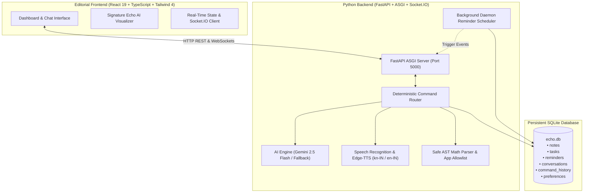

# PROJECT ECHO: NEXT-GENERATION BILINGUAL AI DESKTOP ASSISTANT


> **Commercial-Grade, Bilingual (English & Kannada) AI Desktop Assistant with Editorial Warm-Palette UI, Cinematic Visualizer, Real-Time Hardware Telemetry, AST Safe Math, Background Schedulers, and Voice Synthesis.**

---

## 1. System Architecture



---

## 2. Visual Identity & Design Tokens

Project Echo adheres to a bespoke warm editorial design palette:

| Element | Hex Code | Purpose |
|---|---|---|
| **Primary Background** | `#F8F1E7` | Warm Cream Canvas |
| **Secondary Background** | `#EFE3D3` | Elevated Sub-surfaces |
| **Primary Accent** | `#D97745` | Burnt Orange (Buttons, Visualizer, Active states) |
| **Secondary Accent** | `#B95F38` | Deep Terracotta |
| **Primary Typography** | `#29241F` | Deep Charcoal Heading & Body |
| **Secondary Typography** | `#81766B` | Warm Muted Metadata |
| **Card Background** | `#FFFDF9` | Clean Eggshell Panels |
| **Border Color** | `#E8DCCD` | Elegant Soft Borders |
| **Soft Orange Tint** | `#F4E1D2` | Badges, Highlights & Glows |

**Typography**: Playfair Display & DM Serif Display (Headings) paired with Inter & Manrope (Body).

---

## 3. Key Modules & Technical Capabilities

### 1. Bilingual Voice Engine (`backend/services/speech_service.py`)
- **Speech-to-Text**: Native multi-lingual recognition supporting Indian English (`en-IN`) and Kannada (`kn-IN`).
- **Text-to-Speech**: High-fidelity Microsoft Neural voices (`en-IN-NeerjaNeural` and `kn-IN-SapnaNeural`), with fallback to Windows SAPI `pyttsx3`.
- **Interruptible Playback**: Immediate non-blocking stopping via `POST /api/voice/stop-speaking`.

### 2. Deterministic Command Router (`backend/services/command_router.py`)
- **Zero-Latency Local Execution**: Calculator, hardware telemetry, notes, tasks, weather, and application management resolve instantly without network roundtrips to the LLM.
- **Generative AI Fallback**: Multi-turn contextual conversation routed to Google Gemini (`gemini-2.5-flash`), with graceful offline fallback explanations.

### 3. Air-Tight Security & Safe Execution
- **Safe Math Evaluation**: Utilizes Python `ast.parse` and operator mapping. Zero usage of dangerous `eval()`.
- **Process Whitelisting**: Strict executable validation for Calculator, Notepad, Paint, CMD, VS Code, and Chrome. No arbitrary shell execution.
- **ACID SQLite Database**: Parameterised queries across all tables (`echo.db`), protecting against SQL injection.

---

## 4. API Endpoints

| Category | Method | Endpoint | Description |
|---|---|---|---|
| **System** | `GET` | `/api/health` | Service health status and version |
| **System** | `GET` | `/api/system/info` | Live CPU, RAM, Disk, and Battery telemetry |
| **System** | `GET` | `/api/status` | Current assistant activity status |
| **AI** | `POST` | `/api/chat` | Contextual conversation and command dispatch |
| **AI** | `GET` | `/api/conversations/{id}` | Conversation history retrieval |
| **Voice** | `POST` | `/api/voice/start` | Start microphone listening thread |
| **Voice** | `POST` | `/api/voice/stop` | Stop microphone listening |
| **Voice** | `POST` | `/api/voice/speak` | Synthesize neural speech audio |
| **Voice** | `POST` | `/api/voice/stop-speaking` | Terminate active audio playback |
| **Notes** | `GET` / `POST` | `/api/notes` | List or create persistent notes |
| **Notes** | `PUT` / `DELETE`| `/api/notes/{id}` | Update or delete persistent note |
| **Tasks** | `GET` / `POST` | `/api/tasks` | List or create todo tasks |
| **Tasks** | `PUT` / `DELETE`| `/api/tasks/{id}` | Update status or delete task |
| **Reminders**| `GET` / `POST` | `/api/reminders` | Schedule reminder with datetime |
| **Apps** | `POST` | `/api/apps/launch` | Safely launch whitelisted application |
| **Settings**| `GET` / `PUT` | `/api/settings` | Retrieve or persist user preferences |

---

## 5. Quickstart & Installation

### Prerequisites
- Python 3.10+ (Tested on Python 3.13.7)
- Node.js 18+ (Tested on Node.js v24.14.0)

### One-Click Launch (Windows PowerShell)
```powershell
.\run_echo.ps1
```

### Manual Launch

**1. Install Dependencies:**
```powershell
python -m pip install -r requirements.txt
npm --prefix frontend install
```

**2. Build Frontend:**
```powershell
npm --prefix frontend run build
```

**3. Run FastAPI Application:**
```powershell
python -m uvicorn backend.main:combined_asgi_app --host 127.0.0.1 --port 5000
```
Open your browser at: `http://127.0.0.1:5000`

---

## 6. Testing

Run the automated test suite verifying SQLite CRUD, security validation, and API routes:
```powershell
python -m pytest backend/tests/test_backend.py -v
```

---

## 7. College Demonstration Script

1. **Introduction**: Open `http://127.0.0.1:5000`. Show the warm cream and burnt orange editorial dashboard, live time/date, and live hardware CPU/RAM gauge.
2. **Signature Visualizer**: Click the central orb or tap the microphone button. Observe the smooth CSS/Framer motion orbital breathing transitions.
3. **Local Tool Execution**: Type `calculate 15 * 6 + 10` or speak `calculate 25 times 4`. Observe the instant AST calculation response without API latency.
4. **Application Automation**: Type `open notepad` or `open calculator`. Watch the Windows process start instantly with full allowlist protection.
5. **Bilingual Demonstration**: Switch language toggle to **ಕನ್ನಡ (Kannada)**. Type or speak `ನಮಸ್ಕಾರ, ಸಮಯ ಎಷ್ಟು?`. Echo responds with the Kannada time and audio greeting.
6. **Productivity Persistence**: Add a task and a note. Refresh the browser page or restart the server. Show that all data is retained in `echo.db`.
